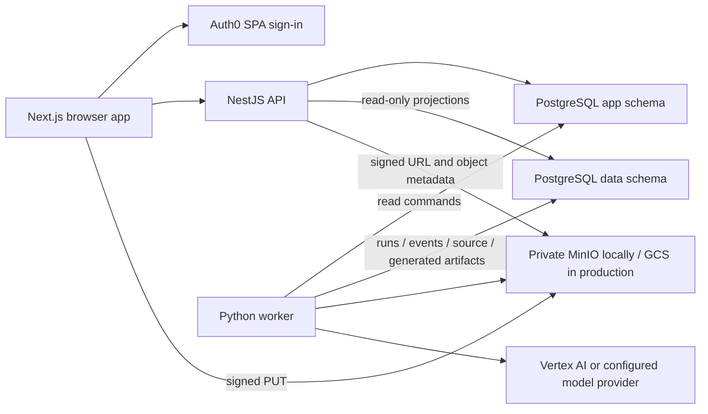

# Agent Handoff

Prepared October 14, 2026. Read `AGENTS.md` first and use
`new-device-setup.md` for installation. This is a source-grounded handoff,
not a guarantee that live configuration will remain unchanged.

## Current Git And Verification Snapshot

- Baseline application commit: `e8bbcba`, on `master` and `origin/master`.
- Its Deploy to GKE run from October 11, 2026 completed successfully.
- On October 14, the web, API, and worker pods were Running and ready.
- The older `codex/processing-pipeline` worktree was clean, with no commits
  missing from `master`. It is not required to continue from a fresh clone.
- The handoff itself is committed after that baseline; use current Git history
  rather than assuming `e8bbcba` is always HEAD.
- No new automated tests are authorized by default. Existing checks may run.
  Prior web checks passed, with React `act(...)` warnings in the existing suite.
- A complete real-provider browser flow has not been confirmed in this chat.

## System Map



| Area | Start reading | Responsibility |
| --- | --- | --- |
| Web | `apps/web/src/components/auth/auth0-provider.tsx`, `lib/bookwise-api.ts` | Auth0 SPA, access-token attachment |
| Library/upload | `apps/web/src/components/library/` | Signed upload, finalization, library status |
| Book detail | `apps/web/src/components/book/book-detail-screen.tsx` | Status and accepted-summary presentation |
| API composition | `services/api/src/app.module.ts` | Environment-driven providers and dependencies |
| Identity | `services/api/src/infrastructure/identity/oidc-token-verifier.ts` | Signature, issuer, audience, verified-email claims |
| API persistence | `services/api/src/infrastructure/database/` | Owner-scoped app writes and data projection reads |
| Worker | `services/data/src/bookwise_data/workers/bootstrap.py` | Long-lived direct database polling loop |
| Processing | `services/data/src/bookwise_data/application/` | Claim, ingestion, generation, events |
| Claims | `services/data/src/bookwise_data/infrastructure/database/command_repository.py` | Advisory locks, leases, heartbeats |
| Database | `infrastructure/database/migrations/`, `roles/` | Ordered migrations and ownership boundaries |
| Production | `.github/workflows/deploy-gcp.yml`, `infrastructure/gcp/` | Reusable verification, images, migration gate, rollouts |

Redis/Celery dependencies exist, but the current worker entry point polls
PostgreSQL directly. Do not infer a Celery queue deployment from dependencies
or the generated graph. Python owns `data`; worker writes must not mutate
immutable `app.processing_commands`.

## Upload And Processing Lifecycle

1. `POST /v1/books/uploads` creates a `pending_upload` book and a signed ticket.
2. The browser PUTs the actual file with the exact ticket content type.
3. `POST /v1/books/:bookId/uploads/finalize` verifies storage and idempotently
   queues `ingest_book` and `regenerate_summary`.
4. Worker ingestion claims immediately; generation waits for normalized source.
5. Runs and events update the owner-scoped processing projection.
6. Accepted summaries are read at `GET /v1/books/:bookId/summary`.

Claims use nonblocking transaction-scoped advisory locks keyed by command ID,
not row locks on application commands. Run leases/heartbeats retain ownership
after the claim transaction ends.

`pending_upload` is not an active job. Detail pages explain that upload is
incomplete, link back to the library, and stop automatic polling for that entry.
Active queued/running/retrying entries poll; terminal states stop intervals.
Library status uses a polled run state before command/book fallback.
Upload failure console warnings include only stage, book ID, storage status,
fixed reason, and retry flags. Never add token, signed-URL, file-content,
filename, or raw-exception logging.

## Production Inventory

| Component | Configuration / purpose |
| --- | --- |
| GCP project | `bookwise-509408` (number `867491686139`) |
| Region / namespace | `asia-southeast1` / `bookwise` |
| GKE | `bookwise-autopilot`; deployments `bookwise-web`, `bookwise-api`, `bookwise-worker` |
| Cloud SQL | `bookwise-postgres`, DB `bookwise_next`; connection `bookwise-509408:asia-southeast1:bookwise-postgres` |
| SQL access | API and worker sidecar proxies at `127.0.0.1:5432` |
| Artifact Registry | `asia-southeast1-docker.pkg.dev/bookwise-509408/bookwise` |
| GCS | Private `bookwise-509408-storage`; reviewed CORS in `infrastructure/gcp/storage-cors.json` |
| Vertex AI | `global`; `gemini-2.5-flash`, `gemini-embedding-001`, 768 embedding dimensions in runtime ConfigMap |
| Public origin | `https://tai-dev-web.cloud` for web and `/v1` API |
| Ingress / TLS | `bookwise-ip` = `35.201.95.210`; Google-managed `bookwise-certificate` |
| Secret Manager | See `infrastructure/gcp/secrets/README.md`; source of runtime server settings |
| Deployment identity | GitHub OIDC federation; no long-lived GCP key required |

Use `infrastructure/gcp/runbook.md` for actual operational commands. New-device
access needs login and permissions, not cloud resource provisioning.

## Authentication Values That Must Stay Aligned

```text
Auth0 tenant / issuer: dev-p8c5tpe1ghv8qtxf.us.auth0.com
OIDC_ISSUER: https://dev-p8c5tpe1ghv8qtxf.us.auth0.com/
SPA client ID: U3USwzKKexcx7Y2FkWVTRznXrK7dTdaq (public)
Auth0 API identifier: https://api.bookwise.local
NEXT_PUBLIC_AUTH0_AUDIENCE: https://api.bookwise.local
Secret Manager bookwise-oidc-audience: https://api.bookwise.local
Production NEXT_PUBLIC_API_URL: https://tai-dev-web.cloud
Production NEXT_PUBLIC_AUTH0_REDIRECT_URI: https://tai-dev-web.cloud
```

The audience is not a DNS endpoint. Do not replace it with the public domain.
The API also requires access-token claims `https://bookwise.local/email` and
`https://bookwise.local/email_verified=true`. Their namespace is independent
of the public origin. Never relax issuer/signature/audience, verified-email,
or owner checks to work around configuration mistakes.

Next.js public values are baked into browser JavaScript: correcting GitHub
variables requires a web rebuild/deployment, not just a ConfigMap update.
Secret changes need Kubernetes synchronization and a process restart; an
already-running process does not reread env-from secrets.

## Recent Incidents And Fixes

- TLS 525: Cloudflare proxying prevented Google-managed certificate validation.
  DNS-only routing resolved that incident. Recheck DNS/certificate state before
  changing infrastructure.
- Auth0 callback mismatch: placeholder callback/API URLs were replaced with
  the real public origin.
- API 401: frontend audience and API audience differed; aligned to the API
  identifier above.
- Auth0 "Service not found": a later GitHub audience change to the public
  domain was baked into web JavaScript. Restoring the identifier and rebuilding
  resolved the configuration mismatch.
- Browser upload failure: bucket lacked CORS. Exact-origin PUT CORS was applied;
  signed diagnostic upload succeeded and unrelated origins were denied.
- Book `d665bc2b-6575-46c9-b444-4077e9964e43`: old failed ticket had no GCS
  original, processing commands, runs, or events. It was not a stalled worker.
  The status repository returned `pending_upload` promptly. Guidance and
  polling behavior were corrected in `e8bbcba`.
- CI/CD: reusable verification, scoped image caches, digest-based deployments,
  and a shared migration-before-application gate were added in `cc02451`.

## Boundaries And Remaining Work

- Do not log or replay old credentials from conversation history.
- Preserve user edits. No destructive resets, volume deletion, or production
  migrations without an explicit task and verified target.
- Empty worker logs do not prove an idle or healthy pipeline: the current worker
  lacks routine lifecycle logging. Inspect durable commands/runs/events with
  read-only, owner-scoped diagnostics; never dump whole user tables.
- API health checks prove process availability, not DB/model/storage readiness.
- A browser Network entry stuck Pending is different from a returned
  `pending_upload` JSON status. The earlier hanging-request report was not
  reproduced end to end with the user's authenticated browser.
- Upload resume across browser restarts, private search, cited question
  answering, and operational observability remain future work.
- Older specs/plans are historical and may contain superseded locking or auth
  designs. Source, migrations, current deployment docs, and live inspection
  take precedence. Confirm new documentation scope with the user.
- The Obsidian vault and its earlier GCP guide are outside Git and were not
  updated or verified in this handoff.

## First Session Checklist

1. Check branch, status, recent commits, installed tools, and missing `.env`.
2. Read the files relevant to the user's task and preserve ownership boundaries.
3. Run existing checks from `new-device-setup.md`; report limits explicitly.
4. For a production incident, inspect current configuration and logs before
   proposing changes. Never assume the snapshot above is still live.
5. Implement only the requested scope; compare docs at completion and obtain
   permission for updates. Pushes to `master` deploy production automatically.
